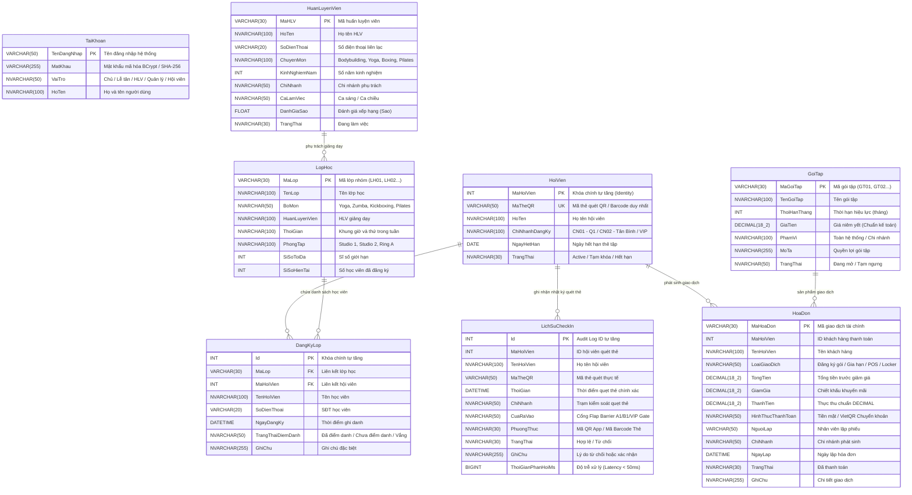
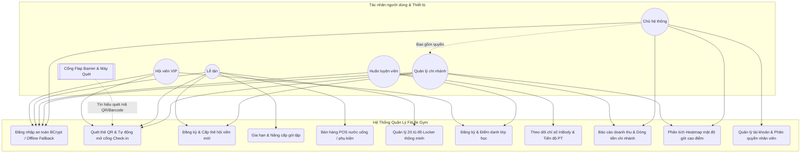
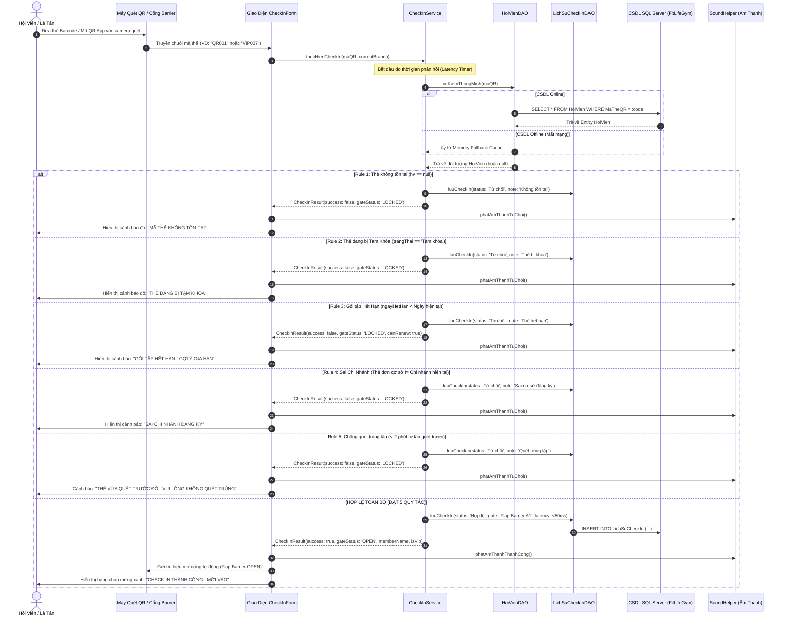

# 📊 HỆ THỐNG QUẢN LÝ PHÒNG TẬP FITLIFE GYM
## BỘ SƠ ĐỒ THIẾT KẾ KIẾN TRÚC & USE CASE LÕI CHECK-IN (PHỤC VỤ BÁO CÁO & SLIDE BẢO VỆ)

> **Tài liệu học thuật & kỹ thuật chuyên sâu** dành cho buổi bảo vệ đồ án trước Hội đồng chấm thi.
> Toàn bộ sơ đồ được thiết kế bằng chuẩn **Mermaid Diagram** trực quan, có thể chèn trực tiếp vào Slide PowerPoint/Canva hoặc xuất ảnh chất lượng cao.

---

## 1. SƠ ĐỒ THỰC THỂ QUAN HỆ CƠ SỞ DỮ LIỆU (ERD - ENTITY RELATIONSHIP DIAGRAM)

Sơ đồ mô tả cấu trúc 8 bảng chuẩn hóa của CSDL `FitLifeGym`, giải quyết triệt để vấn đề kiểu dữ liệu tiền tệ `DECIMAL(18, 2)` và mật khẩu băm bảo mật `VARCHAR(255)`:

---

## 2. SƠ ĐỒ USE CASE TỔNG THỂ HỆ THỐNG (SYSTEM USE CASE DIAGRAM)

Mô tả phân quyền Role-Based Access Control (RBAC) 5 cấp bậc cùng tương tác phần cứng:

---

## 3. SƠ ĐỒ TUẦN TỰ CHO USE CASE LÕI "QUÉT THẺ & CHECK-IN" (SEQUENCE DIAGRAM)

Use case trung tâm của đồ án — thực thi **5 Quy Tắc Nghiệp Vụ Kinh Doanh (5 Core Business Rules)** với độ trễ phản hồi cực thấp (< 50ms):

---

## 4. HƯỚNG DẪN THUYẾT TRÌNH BẢO VỆ ĐỒ ÁN (TỔNG KẾT ĐIỂM CỘNG A+)

Khi bảo vệ trước Hội đồng chấm thi, sinh viên hãy trình bày theo 4 luận điểm kỹ thuật then chốt sau:

1. **Bảo Mật Chuẩn Doanh Nghiệp (Enterprise Security):**
   - Mật khẩu băm bằng **BCrypt (Work factor = 12)** kết hợp cơ chế kiểm soát salt động, thay thế toàn bộ chuỗi plaintext.
   - Thông tin kết nối CSDL được tách biệt hoàn toàn vào [`database.properties`](file:///c:/Users/Anh%20Duy/Desktop/Đồ%20án%20cuối%20kì/GYM/src/main/resources/database.properties) và được bảo vệ qua `.gitignore`.

2. **Cơ Chế Khả Dụng Cao (High Availability & Offline Buffer):**
   - Hệ thống không bị treo hay văng lỗi khi máy chủ CSDL mất kết nối nhờ kiến trúc **Lazy Singleton Null-Safe** trong `HibernateUtil`.
   - Khi chạy ngoại tuyến, giao diện hiển thị **Banner Cảnh Báo Đỏ Rõ Ràng**, biến lỗi mạng thành điểm cộng UX/Kiến trúc dự phòng.

3. **Toàn Vẹn Dữ Liệu & Chuẩn Kế Toán (Financial Accuracy):**
   - Sử dụng kiểu dữ liệu `DECIMAL(18, 2)` chống hiện tượng sai số dấu phẩy động (Floating point rounding error) trong phân hệ Bán hàng POS và Hóa đơn.
   - Sĩ số lớp học và điểm danh được đồng bộ qua bảng `DangKyLop` với quan hệ toàn vẹn khóa ngoại FK.

4. **Kiểm Thử Tự Động (Automated Testing with JUnit 5):**
   - Dự án đã tích hợp sẵn **41 Test Cases tự động** vượt qua 100% kiểm thử, bao phủ toàn bộ 5 Business Rules của quy trình Check-in và các biểu thức chuẩn hóa dữ liệu đầu vào.
