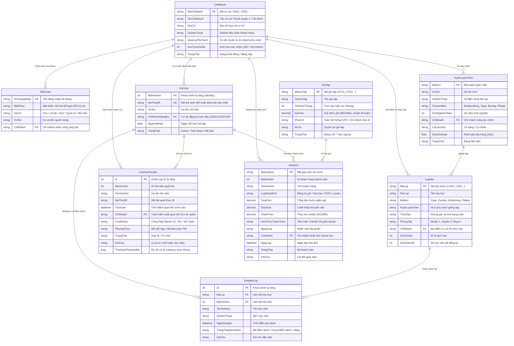
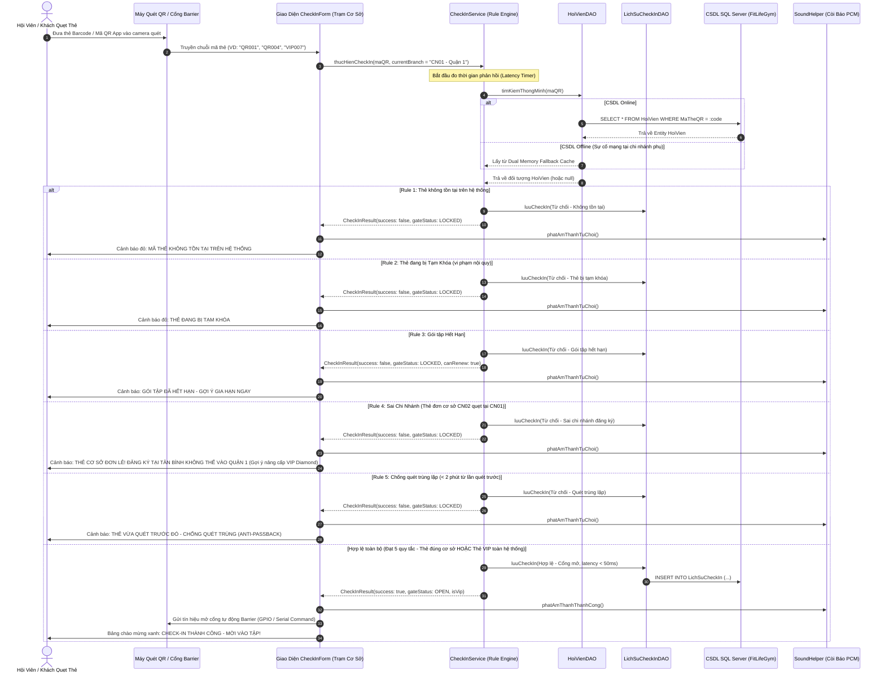

# 📊 HỆ THỐNG QUẢN TRỊ CHUỖI PHÒNG TẬP FITLIFE GYM (MULTI-BRANCH CHAIN)
## BỘ SƠ ĐỒ THIẾT KẾ KIẾN TRÚC & USE CASE LÕI CHECK-IN (PHỤC VỤ BÁO CÁO & SLIDE BẢO VỆ)

> **Tài liệu học thuật & kỹ thuật chuyên sâu** dành cho buổi bảo vệ đồ án trước Hội đồng chấm thi.
> Thiết kế bài toán vận hành **Chuỗi Phòng Tập Thể Hình Đa Chi Nhánh (Multi-Branch Gym Chain Architecture)**, giải quyết triệt để bài toán phân quyền cơ sở, roaming thẻ tập liên chi nhánh và đối soát doanh thu.
> Toàn bộ sơ đồ được thiết kế bằng chuẩn **Mermaid Diagram** trực quan, tương thích 100% với trình xem Markdown của VS Code, GitHub, Notion và Canva.

---

## 1. SƠ ĐỒ THỰC THỂ QUAN HỆ CƠ SỞ DỮ LIỆU (ERD - ENTITY RELATIONSHIP DIAGRAM)

Trong mô hình chuỗi thể hình hiện đại, **`ChiNhanh` (Branch)** đóng vai trò là **Thực Thể Trung Tâm Điều Phối (Core Anchor Entity)**. Mọi hoạt động nghiệp vụ (Hội viên ghi danh, Nhân sự làm việc, Lịch lớp học, Thiết bị phòng tập, Giao dịch tài chính và Lượt quét cổng Check-in) đều được chuẩn hóa liên kết chặt chẽ qua khóa ngoại:

---

## 2. SƠ ĐỒ USE CASE PHÂN CẤP ĐA CHI NHÁNH (SYSTEM USE CASE DIAGRAM)

Mô tả sự phân định rạch ròi giữa **Chủ Chuỗi Hệ Thống (Chain Owner)** có góc nhìn toàn cảnh đa cơ sở và **Quản Lý Chi Nhánh (Branch Operations Manager)** quản lý chuyên biệt theo cơ sở:

```mermaid
flowchart TD
    subgraph Actors [Tác nhân Người Dùng & Thiết Bị]
        Member["Hội viên (Member VIP)"]
        Receptionist["Lễ tân cơ sở (CN01 / CN02)"]
        Trainer["Huấn luyện viên (PT/Coach)"]
        BranchManager["Quản lý chi nhánh (Branch Manager)"]
        ChainOwner["Chủ chuỗi hệ thống (Chain Owner)"]
        FlapBarrier["Cổng Flap Barrier & Máy Quét USB"]
    end

    subgraph BranchOps [Nghiệp Vụ Cấp Chi Nhánh Cơ Sở]
        UC_CheckIn["Quét thẻ QR & Mở cổng Check-in"]
        UC_RegisterMember["Đăng ký & Cấp thẻ tại cơ sở"]
        UC_RenewPackage["Gia hạn gói tập tại quầy"]
        UC_POS["Bán hàng POS nước uống & phụ kiện"]
        UC_Locker["Quản lý tủ Locker chi nhánh"]
        UC_ClassAttendance["Điểm danh lớp học Studio cơ sở"]
        UC_ShiftSchedule["Xếp lịch trực ca tuần nhân viên cơ sở"]
        UC_BranchEquip["Quản lý & Bảo trì máy móc cơ sở"]
        UC_BranchCapacity["Theo dõi sức chứa & lưu lượng cơ sở"]
    end

    subgraph ChainLevel [Nghiệp Vụ Chuỗi Cấp Cao Hệ Thống]
        UC_CrossBranchReport["Báo cáo so sánh doanh thu đa chi nhánh"]
        UC_PeakHeatmap["Phân tích Heatmap mật độ giờ cao điểm 2 cơ sở"]
        UC_ChainEmployee["Quản lý & Điều chuyển nhân sự liên chi nhánh"]
        UC_BranchCatalog["Quản lý danh mục & Thông số các chi nhánh"]
        UC_PackageScope["Cấu hình phạm vi gói tập (Đơn cơ sở vs Toàn chuỗi)"]
    end

    %% Hội viên
    Member --> UC_CheckIn
    Member --> UC_ClassAttendance

    %% Thiết bị phần cứng
    FlapBarrier --> UC_CheckIn

    %% Lễ tân chi nhánh
    Receptionist --> UC_CheckIn
    Receptionist --> UC_RegisterMember
    Receptionist --> UC_RenewPackage
    Receptionist --> UC_POS
    Receptionist --> UC_Locker

    %% HLV
    Trainer --> UC_ClassAttendance

    %% Quản lý chi nhánh
    BranchManager --> UC_ShiftSchedule
    BranchManager --> UC_BranchEquip
    BranchManager --> UC_BranchCapacity
    BranchManager --> UC_CheckIn
    BranchManager --> UC_RegisterMember

    %% Chủ chuỗi hệ thống
    ChainOwner --> UC_CrossBranchReport
    ChainOwner --> UC_PeakHeatmap
    ChainOwner --> UC_ChainEmployee
    ChainOwner --> UC_BranchCatalog
    ChainOwner --> UC_PackageScope
```

---

## 3. SƠ ĐỒ TUẦN TỰ: USE CASE LÕI CHECK-IN LIÊN CHI NHÁNH (SEQUENCE DIAGRAM)

Use case trung tâm của đồ án — thực thi **5 Quy Tắc Nghiệp Vụ Kinh Doanh (5 Core Business Rules)** với độ trễ phản hồi cực thấp (< 50ms), đặc biệt làm nổi bật **Quy tắc 4: So khớp thẻ cơ sở đơn lẻ vs Thẻ VIP toàn chuỗi**:

---

## 4. CHUYÊN ĐỀ PHÂN TÍCH: BÀI TOÁN QUẢN TRỊ CHUỖI ĐA CHI NHÁNH FITLIFE GYM

Khi bảo vệ trước Hội đồng, sinh viên giải trình sâu 5 khía cạnh kiến trúc đa chi nhánh để khẳng định đẳng cấp phần mềm:

### 4.1. Kiến Trúc Chuỗi 2 Cơ Sở Trọng Điểm:
- **Cơ sở 1 (CN01 - Flagship Center - Quận 1):** Sức chứa 180 khách, trang bị đầy đủ Studio Yoga, Ring Boxing, khu Functional, phục vụ phân khúc khách hàng văn phòng và hội viên cao cấp.
- **Cơ sở 2 (CN02 - Premium Branch - Tân Bình):** Sức chứa 120 khách, tập trung vào Pilates, Zumba và CrossFit, phục vụ cư dân và sinh viên khu vực Tây Bắc TP.HCM.

### 4.2. Chính Sách Phân Quyền Dữ Liệu Theo Chi Nhánh (Branch-Level Data Isolation):
- Nhân viên Lễ tân (`letan1`) chỉ thao tác bán hàng POS, giao tủ Locker và duyệt check-in cho khách tại quầy cơ sở của mình.
- Quản lý chi nhánh (`quanly1`) theo dõi chỉ số sức chứa, lập bảng xếp ca trực tuần cho nhân sự cơ sở mình phụ trách.
- Chủ hệ thống (`admin`) sở hữu thanh công cụ **Active Branch Selector**, cho phép chuyển đổi nhanh giữa:
  * `🏢 Toàn hệ thống (2 cơ sở)`: Tổng hợp doanh số, đối soát dòng tiền và cân đối nhân sự toàn chuỗi.
  * `📍 CN01 - Quận 1 (Flagship)`: Đi sâu vào chi tiết vận hành trụ sở chính.
  * `📍 CN02 - Tân Bình (Premium)`: Giám sát riêng cơ sở phụ.

### 4.3. Chính Sách Phân Cấp Thẻ Tập (Membership Tiering & Roaming):
- **Thẻ Cơ Sở Đơn Lẻ (Single-Branch Pass - GT01/GT02/GT06):** Giá vé tiết kiệm (350k - 500k/tháng), hội viên chỉ được check-in tại chi nhánh đã ghi danh. Nếu sang cơ sở khác, cổng Barrier sẽ tự động khóa và gợi ý nâng cấp thẻ.
- **Thẻ VIP Diamond Toàn Chuỗi (All-Branch VIP Pass - GT04):** Giá 4.500.000 VNĐ/năm, cho phép ra vào tự do mọi cơ sở trong chuỗi FitLife Gym với quyền ưu tiên lối đi VIP Gate riêng.

### 4.4. Giải Pháp Dự Phòng Khi Mạng Chi Nhánh Chập Chờn (Dual Cache Circuit Breaker):
- Đặc thù hạ tầng mạng tại các chi nhánh thể thao thường xuyên gặp sự cố đứt kết nối internet tới SQL Server trung tâm.
- Nhóm 12 đã hiện thực kiến trúc **Bộ Nhớ Đệm Kép Thread-Safe (`CopyOnWriteArrayList`)** trong `ChiNhanhDAO`, `HoiVienDAO`, `LichSuCheckInDAO`. Khi mất mạng, trạm quét tự động chuyển sang chế độ đệm nội bộ, duy trì tốc độ mở cổng < 50ms mà không làm ách tắc hàng dài khách tập vào giờ cao điểm.

### 4.5. Đối Soát Doanh Thu & Báo Cáo Tài Chính Chuỗi (Cross-Branch Financial Consolidation):
- Mỗi hóa đơn (`HoaDon`) và lịch sử quét thẻ (`LichSuCheckIn`) đều gắn chặt với mã chi nhánh phát sinh `ChiNhanh`.
- Trung tâm Báo cáo Thống kê hỗ trợ xuất file Excel chuẩn UTF-8 BOM, phân tách rạch ròi doanh thu từng cơ sở, hỗ trợ tính lương thưởng KPIs cho nhân viên và phân tích điểm hòa vốn cho từng chi nhánh.
